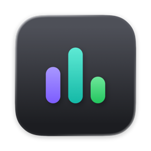
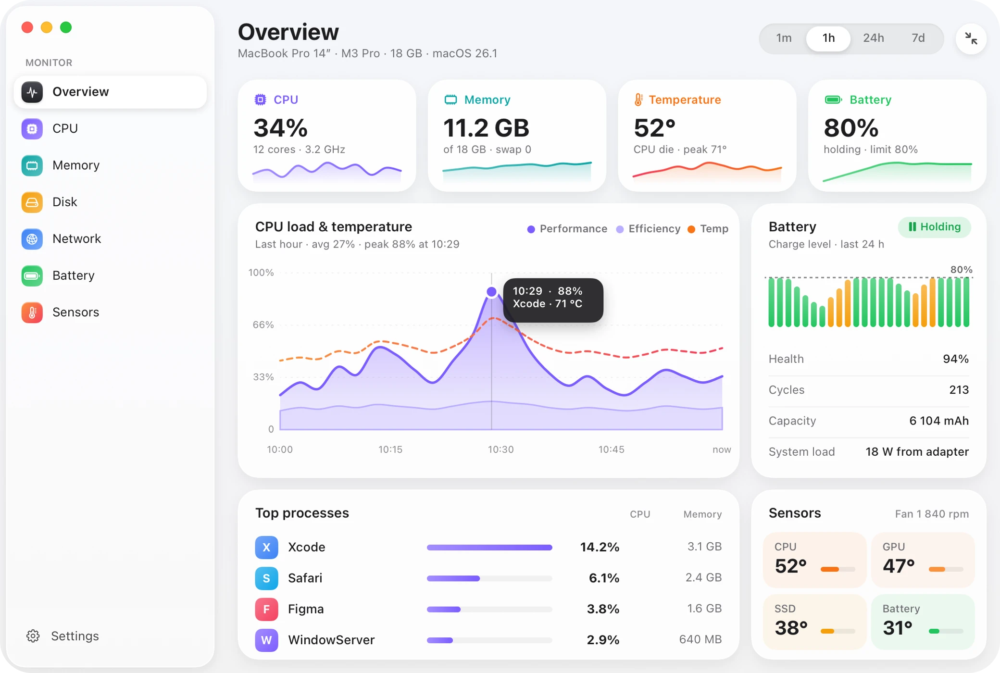
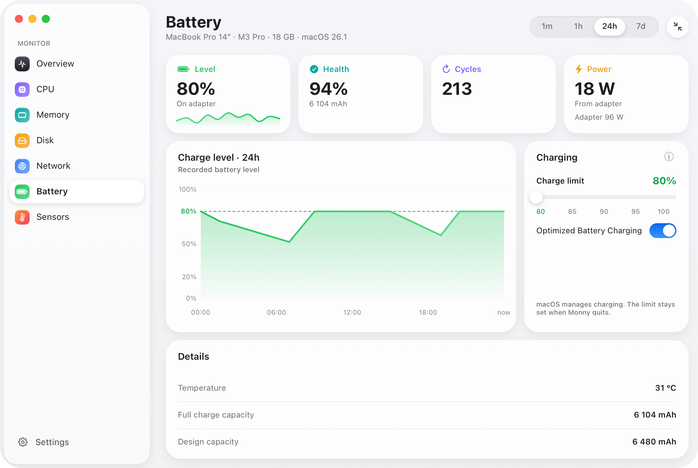
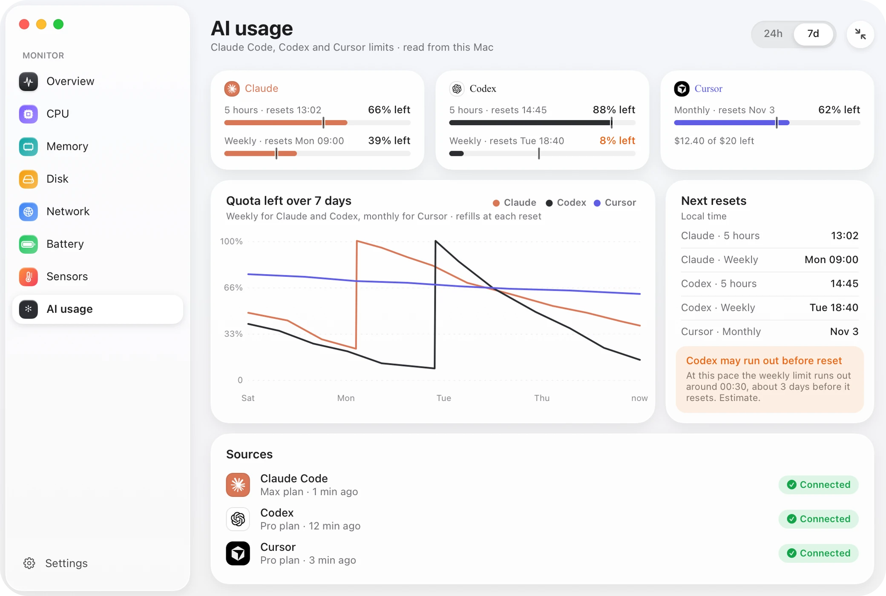
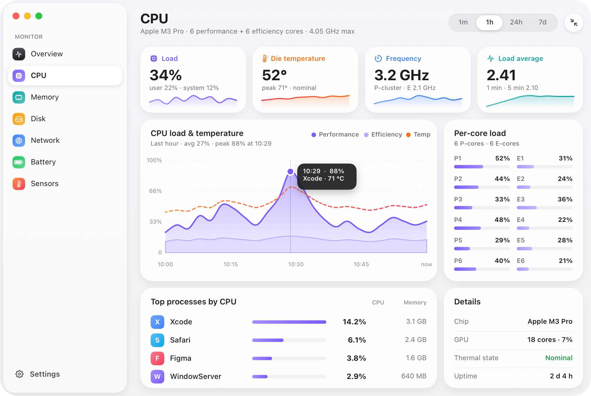
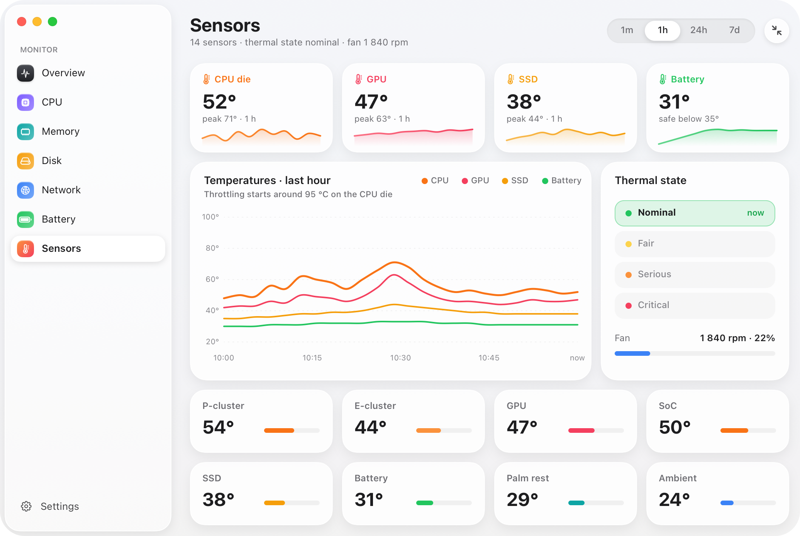

<p align="center">
  
</p>

<h1 align="center">Monny</h1>

<p align="center">
  <strong>See what your Mac is doing, protect your battery, and track AI subscription limits.</strong><br />
  Free, open source, and native for Apple silicon on macOS 15+.
</p>

<p align="center">
  <a href="https://github.com/Blinks44/monny/actions/workflows/website.yml"></a>
  <a href="https://github.com/Blinks44/monny/releases/latest"></a>
  <a href="LICENSE"></a>
  <a href="https://monny.moduix.dev"></a>
</p>

<p align="center">
  <a href="https://monny.moduix.dev">Website</a> ·
  <a href="https://github.com/Blinks44/monny/releases/latest">Download</a> ·
  <a href="#installation">Install</a> ·
  <a href="#why-monny">Features</a> ·
  <a href="docs/README.md">Docs</a> ·
  <a href="SECURITY.md">Security</a>
</p>

<p align="center">
  <picture>
    <source media="(prefers-color-scheme: dark)" srcset="apps/website/public/screenshots/overview-dark.webp" />
    <source media="(prefers-color-scheme: light)" srcset="apps/website/public/screenshots/overview-light.webp" />
    
  </picture>
</p>

---

## Why Monny?

Most Mac monitors either eat CPU themselves, require a privileged root helper just to cap battery charging, or miss the tools developers actually watch every day, like which process holds port `3002` or how much of your Claude Code, Codex, or Cursor limit is left.

Monny brings all of it into one lightweight SwiftUI/AppKit app:

- **Instant menu bar popover (`⌥⌘M`):** live CPU, memory, disk, network, per-core load, battery status, and top processes in one click.
- **Full dashboard with 7-day history:** Overview, CPU, Memory, Disk, Network, Battery, and Apple silicon thermal/fan Sensors with `1m` to `7d` charts and preserved sleep gaps.
- **Port & process finder:** search by port or PID (`3002`, `localhost:3002`), see the working directory where a process started, and quit runaway tasks directly.
- **Native battery charge limit (80–100%):** adjusts the built-in macOS 26.4+ charge limit as an ordinary user (**no root helper**), and macOS keeps enforcing it even after Monny quits.
- **AI subscription quotas (optional, off by default):** live remaining quota bars and reset timers for **22 AI coding tools** (Claude Code, Codex, Cursor, Antigravity, GitHub Copilot, JetBrains AI, Grok, Gemini, Windsurf, Cline, Kimi, Augment, and more) read locally via each tool's own sign-in.
- **Smart notifications:** alerts for charge limit reached, high temperature, low battery, memory pressure, and runaway CPU processes.
- **6 languages:** English, Русский, Deutsch, Français, Español, and 简体中文.

Readings never leave your Mac: no account, no analytics, no telemetry.

<details>
<summary>More screenshots (Battery &amp; Charge Limit, 22 AI Quotas, CPU &amp; Thermal History, SMC Sensors)</summary>
<br />

| Battery &amp; Native Charge Limit | 22 AI Subscription Quotas |
| --- | --- |
| <picture><source media="(prefers-color-scheme: dark)" srcset="apps/website/public/screenshots/battery-dark.webp" /></picture> | <picture><source media="(prefers-color-scheme: dark)" srcset="apps/website/public/screenshots/ai-usage-dark.webp" /></picture> |

| CPU P/E Cores &amp; History | Apple Silicon SMC Sensors |
| --- | --- |
| <picture><source media="(prefers-color-scheme: dark)" srcset="apps/website/public/screenshots/cpu-dark.webp" /></picture> | <picture><source media="(prefers-color-scheme: dark)" srcset="apps/website/public/screenshots/sensors-dark.webp" /></picture> |

</details>

---

## Installation

Requires **Apple silicon** and **macOS 15 or later** (native charge limit requires macOS 26.4+ on a Mac with a battery).

### Homebrew (recommended)

```sh
brew install --cask blinks44/tap/monny
```

### Direct download

1. Download [Monny.dmg](https://github.com/Blinks44/monny/releases/latest/download/Monny.dmg) from [GitHub Releases](https://github.com/Blinks44/monny/releases/latest).
2. Open the DMG and drag **Monny** into **Applications**.
3. Verify integrity (optional) with `SHA256SUMS.txt`:

```sh
shasum -a 256 -c SHA256SUMS.txt
```

### First launch note

Monny is signed with a stable certificate (so macOS preserves permissions across updates), but is **not yet notarized by Apple**. On first launch, allow it once via either method:

- **System Settings:** open Monny, dismiss the warning, then go to **System Settings → Privacy & Security → Open Anyway**.
- **Terminal:** remove the download quarantine attribute:

```sh
xattr -dr com.apple.quarantine /Applications/Monny.app
```

Subsequent updates arrive automatically through [Sparkle](https://sparkle-project.org) with Ed25519 signature verification (**Check for Updates** in the menu bar right-click menu).

---

## Repository Layout

| Path | Contents |
| --- | --- |
| `apps/monny/` | Native macOS app (Xcode project, Swift 6 sources, Swift Testing suite, `scripts/dev.sh`, `scripts/release.sh`) |
| `apps/website/` | Public landing page ([monny.moduix.dev](https://monny.moduix.dev)): TanStack Start, React 19, `@moduix/react`, Paraglide i18n, Cloudflare Workers |
| `docs/` | Product spec, design guidelines, engineering invariants, build/release docs, and hardware research |

---

## Build From Source

Requires full Xcode with a **Swift 6.2+ compiler** and a **macOS 26+ SDK**.

```sh
apps/monny/scripts/dev.sh doctor   # check Xcode toolchain & targets
apps/monny/scripts/dev.sh run      # build Debug and launch Monny.app
apps/monny/scripts/dev.sh test     # run Swift Testing suite
apps/monny/scripts/dev.sh lint     # format & lint checks
```

You can also open `apps/monny/monny.xcodeproj` in Xcode, select the **monny** scheme, and press **⌘R**. See [docs/DEVELOPMENT.md](docs/DEVELOPMENT.md) for Release packaging and signing details.

---

## Technology

| Area | Stack |
| --- | --- |
| Language & UI | Swift 6 strict concurrency, SwiftUI, Swift Charts, AppKit menu bar status item |
| Telemetry | Mach host statistics, IOKit, Apple silicon SMC sensors, `ProcessInfo`, power-source APIs |
| Battery control | Native macOS 26.4+ charge limit (no privileged helper) |
| Updates & shortcuts | [Sparkle](https://sparkle-project.org) (Ed25519 signed), [KeyboardShortcuts](https://github.com/sindresorhus/KeyboardShortcuts) |
| Localization & tests | String Catalogs (6 languages), Swift Testing |

---

## Acknowledgements

See [NOTICE.txt](NOTICE.txt) for full third-party attributions and licenses.

- [Stats](https://github.com/exelban/stats) (MIT): SMC temperature and fan sensor key references.
- [CodexBar](https://github.com/steipete/CodexBar) (MIT): reference for local AI quota endpoints and storage locations (no code copied).
- [Sparkle](https://sparkle-project.org) (MIT), [KeyboardShortcuts](https://github.com/sindresorhus/KeyboardShortcuts) (MIT), and [create-dmg](https://github.com/create-dmg/create-dmg) (MIT).

---

## Also by Sergey V.

- [**Hearth**](https://hearth.moduix.dev): Local dev environment dashboard for runtimes, projects, Docker, Kubernetes, databases, and AI agents.
- [**Rebind**](https://rebind.moduix.dev): Native macOS utility for remapping keys, mouse buttons, Logitech mice, and trackpad gestures.

---

## License

Released under the [MIT License](LICENSE). Made by Sergey V. ([@TheBlinks182](https://x.com/TheBlinks182)).
