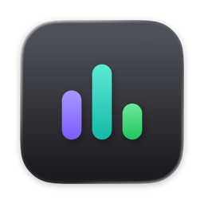

<p align="center">
  
</p>

<h1 align="center">Monny</h1>

<p align="center">
  See what your Mac is doing, and keep its battery healthy while it stays plugged in.<br>
  Free, open source, native on macOS 26+.
</p>

A native macOS menu bar utility for resource monitoring and battery charge control. A click on the menu bar icon shows CPU, memory, disk, network, cores and battery at a glance; a dashboard window adds history charts, top processes and temperature sensors. Battery controls use the built-in macOS charge limit where available; macOS manages charging.

**Status:** early development. Monitoring, history, dashboard pages and Settings are implemented. The native-only charge-limit setting and design/copy cleanup are under review. Discharge experiments are preserved separately on `experiments/discharge`. See the [current state](docs/STATE.md) and [roadmap](docs/PLAN.md).

## Repository layout

| Path | Contents |
| --- | --- |
| `apps/monny/` | The macOS app: Xcode project, sources, tests and the `scripts/dev.sh` build script |
| `apps/website/` | Reserved for the public landing page, built after the app |
| `docs/` | Specification, design notes, roadmap, current state and verification records |
| `AGENTS.md`, `CLAUDE.md`, `.agents/` | Instructions and skills for coding and design agents |

## First-release scope

- **Menu bar popover** with Overview, Battery and Processes tabs, refreshed every few seconds, and a global shortcut (⌥⌘M by default).
- **Dashboard window** with Overview, CPU, Memory, Disk, Network, Battery and Sensors pages and 1 minute to 7 day history.
- **Native battery charge limit** from 80–100% on supported macOS 26.4+ systems, without a privileged helper. Discharge, calibration and advanced charging automation are deferred.
- **Notifications** for a measured charge limit, a hot Mac, low battery and high memory pressure; calibration remains deferred.
- English, Russian, German, French, Spanish and Simplified Chinese.

Readings never leave the Mac: no account, analytics or telemetry. The [specification](docs/SPEC.md) lists the full scope and acceptance.

## Requirements

- A Mac with **Apple silicon** running macOS **26 or later**. Intel Macs are not supported. Charge limits need a Mac with a battery, macOS 26.4+ and a compatible native runtime.
- Full Xcode with a **Swift 6.2+ compiler** and a **macOS 26+ SDK** to build from source.

## Build and run

From the repository directory:

```sh
apps/monny/scripts/dev.sh doctor
apps/monny/scripts/dev.sh run
```

`doctor` reports the selected toolchain and project targets. `run` builds Debug and opens `Monny.app`. The script selects full Xcode per process without changing your system's `xcode-select` setting. Alternatively, open `apps/monny/monny.xcodeproj` in Xcode, select the **monny** scheme and run with **⌘R**. See the [development guide](docs/DEVELOPMENT.md) for tests, Release builds and signing.

## Install

There is no release yet. Monny will be distributed as a signed DMG on GitHub Releases, outside the Mac App Store, because battery control needs a privileged helper that the App Store does not allow.

## Technology

| Area | Stack |
| --- | --- |
| Language and UI | Swift 6 language mode, SwiftUI, Swift Charts, AppKit for the menu bar item |
| Readings | Mach host statistics, IOKit, `ProcessInfo`, Network and power-source APIs (to be confirmed per metric in [research](docs/research/README.md)) |
| Battery control | Privileged helper registered with Service Management, XPC |
| Localization | String Catalogs |
| Tests | Swift Testing with an Xcode-hosted test target |
| Design | Sketch, SF Symbols |

## Documentation

- [Development guide](docs/DEVELOPMENT.md): build, tests and signing.
- [Specification](docs/SPEC.md) and [roadmap](docs/PLAN.md): product requirements and remaining work.
- [Documentation index](docs/README.md): design, engineering conventions, verification and contributor/agent workflow.
- [Contributing](CONTRIBUTING.md), [security policy](SECURITY.md), [code of conduct](CODE_OF_CONDUCT.md) and [changelog](CHANGELOG.md).

## License

Monny is released under the [MIT License](LICENSE).
